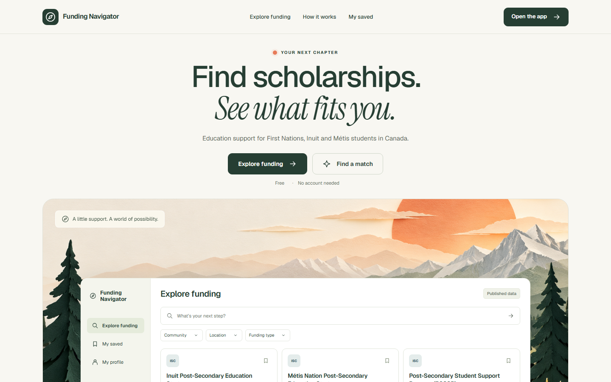
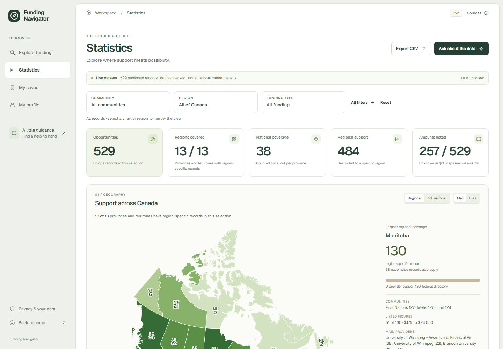
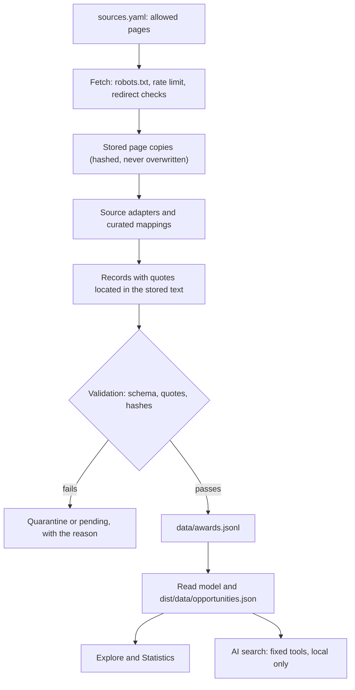

<div align="center">

# Indigenous Student Funding Navigator

**A free funding board for First Nations, Inuit and Métis students in Canada, with a source and a quote behind every record**

[](LICENSE)
[](pyproject.toml)
[](deploy/streamlit/requirements.txt)
[](https://funding-navigator.streamlit.app/)
[](https://youtu.be/a0TR5dglQrQ)

[Live app](#live-app) · [What it does](#what-it-does) · [How it works](#how-it-works) · [Data and sources](#2-data-and-how-it-supports-the-result) · [Run it locally](#3-run-it-locally) · [Layout](#repository-layout) · [License](#license)



</div>

## 1. Idea and choices

Funding for Indigenous students sits in separate places: federal programs, Inuit and Métis programs, university awards and private foundations. Each has its own rules and dates. This project puts 529 records in one board. You can search and filter them, see on a map where support is, and read the provider's own words and a link to its page for each record.

It was built for a datathon in 2026. What is notable about it:

- Every record cites quotes from a stored copy of the source page, and a test checks that every amount and date shown appears in the quote that supports it.
- The board says what it does not know. A condition that only the provider can judge is shown as "to confirm", not as a yes or a no.
- The optional AI search can only choose among fixed, read-only tools over the published records, so it can only return records that exist.

### Live app

**<https://funding-navigator.streamlit.app/>**

The hosted version has Explore, Statistics and My saved. AI search and chat need a backend and a key, so they are hidden there and the search box does keyword search. Free Streamlit apps go to sleep when nobody visits; if you see a "gone to sleep" page, use its button to wake the app.

A 60-second demo video is on [YouTube](https://youtu.be/a0TR5dglQrQ).

### What it does

- **Explore.** Search and filter by community, study region, funding type, listed amount and more. Each record has a detail page with its amount, deadline rule, source link and what is still to confirm with the provider.
- **Statistics.** A map of Canada and linked charts (region ranking, community coverage, provider share, amount distribution, application timing). Clicking a region, bar or cell filters the rest. The records can be exported as CSV. A region count is the number of records that state that region. It is not a measure of need or of the money available. Records that apply across Canada are counted once and are not painted onto any region on the map ([counting rules](docs/STATISTICS-DESIGN.md), in Chinese).
- **My saved.** Records you save are kept in your browser's local storage, as record IDs only.
- **AI search and chat (optional, local only).** Ask in plain words. See [the AI search](#the-ai-search-what-the-model-may-and-may-not-do).

The app collects no personal data. It has no account system and no field for a name, e-mail, status number or student number.

<p align="center"></p>

### How it works



The pipeline and the app layer are separate. Only the pipeline produces data; the app reads what was published and never writes records of its own. Design notes: [architecture](docs/ARCHITECTURE.md), [application layer](docs/APP_LAYER.md), [runbook](docs/RUNBOOK.md).

#### The data pipeline

1. **Where to look.** [`sources.yaml`](sources.yaml) lists the official start pages and, for each, the domains and paths that may be fetched. Every request and every redirect hop is checked against that list. The fetcher reads `robots.txt`, spaces requests per host (one per second by default), retries a few times and caps response size.
2. **Store what was read.** Each page is saved as a snapshot with a SHA-256 hash and is never overwritten, so a record can be re-checked later without the network.
3. **Turn pages into candidate records.** A parser per source reads the page. The federal directory is read as a table. Free-text pages are mapped by hand in [`data/curated/`](data/curated/README.md), and each fact there is tied to an exact quote. Extraction is deterministic by default (`EXTRACTION_MODE=deterministic` in [`.env.example`](.env.example)).
4. **Check the quotes.** Each quote is looked up in the stored text. A quote that is not on the page does not become a record; it is reported as pending with the reason. Where two official statements disagree, both are kept and the record goes to review instead of one being chosen silently.
5. **Publish.** Records that pass are exported to [`data/awards.jsonl`](data/awards.jsonl). Nothing is deleted because a source stopped listing it. `app publish` writes the same records for the site in `dist/`.

#### The AI search: what the model may and may not do

AI search is off unless `.env` sets `LLM_ENABLED=true`, a model and a key. It calls an OpenAI-compatible Responses API ([`assistant.py`](src/navigator/app/assistant.py), [provider notes](docs/LLM_PROVIDERS.md)).

The model may:

- call five fixed, read-only tools: `search_opportunities`, `find_matches`, `get_opportunity`, `get_statistics` and `get_filter_options`;
- return the IDs of records those tools returned, with reasons chosen from five codes (`community`, `location`, `study_plans`, `amount`, `provider_confirmation`), and one clarifying question.

The model may not:

- run SQL, fetch web pages, read or write files, change data, or follow a URL a user gives it;
- recommend a record that no tool returned in the same request (the answer is rejected if it does);
- supply the facts on a card. Titles, amounts, deadlines and links are read back from the stored record, not from the model's text;
- fill in a profile field the user did not state, or treat an unknown condition as met;
- see e-mail addresses or document numbers: these are refused before any model call.

A request is limited to 4 model rounds, 6 tool calls, 1,800 output tokens and a 20-second provider timeout. When AI search is on, the user's message and any profile they volunteer go to the configured provider. If the provider fails or its output cannot be verified, the app shows an error. It does not fall back to keyword rules and pass them off as AI.

## 2. Data and how it supports the result

**The dataset** is [`data/awards.jsonl`](data/awards.jsonl): 529 published records ([schema](docs/schemas/opportunity-record-1.0.schema.json)), all verified on 2026-10-11 (the data snapshot date). The count is the number of lines in the file (`wc -l`), and the same number of records loads from the JSON.

| Group | Records | How it was read |
| --- | --- | --- |
| Federal directory entries (`isc_bursaries_index`) | 486 | The federal [Indigenous Bursaries Search Tool](https://www.sac-isc.gc.ca/eng/1351185180120/1351685455328), read by machine and checked against the stored page. No deadline or application steps; not reviewed by a person. |
| Provider pages | 43 | Read on the providers' own pages; 25 are from Vancouver Island University's award list and 8 from Simon Fraser University's. |

- Records cover all 13 provinces and territories, plus 38 that apply across Canada and 7 that state no region.
- Every record is `machine_checked`. None is marked as reviewed by a person.
- 257 of the 529 records list an amount. For the rest the source gives none, and the board shows that instead of a guess.
- Most records name more than one community (414 name First Nations, Inuit and Métis together).
- The 529 records come from 316 distinct provider names.

**Permission.** Information from Indigenous Services Canada is reproduced under the Government of Canada's non-commercial reproduction terms, with the statement they require shown in the app. For other providers the project uses public facts and short quotations with a link back and the date checked. A person has not yet read their terms of use (`access_status: unreviewed` in [`sources.yaml`](sources.yaml)). The app's About page offers a contact for corrections or removal.

**Limits.** Directory pages can be years old. A record is a pointer to the provider, not a decision: confirm every deadline and rule with the provider. Why the data looks like this, and the evidence for the problem: [build session 1](docs/build-session-1.md), [data sources](docs/DATA_SOURCES.md), [data model](docs/DATA_MODEL.md).

## 3. Run it locally

Python 3.12 and Git are required (the pinned set was run on 3.12; the project declares 3.11 or newer). Node.js 20+ and Chrome are optional, for the checks.

```powershell
git clone https://github.com/YuzhengShi/Datathon-Season-2026.git
cd Datathon-Season-2026
python -m venv .venv
.\.venv\Scripts\python -m pip install -r requirements.lock
.\.venv\Scripts\python -m pip install --no-deps -e .
.\scripts\start_app.ps1        # builds the database from data/awards.jsonl, then opens http://127.0.0.1:8000/
```

If Windows refuses port 8000, add `-Port 8080`; if PowerShell refuses to run scripts, use `powershell -ExecutionPolicy Bypass -File .\scripts\start_app.ps1`. On macOS or Linux use `source .venv/bin/activate` and `scripts/start_app.sh` (only the Windows script has been run). AI search stays off until `.env` has `LLM_ENABLED=true` and a key ([docs/LLM_PROVIDERS.md](docs/LLM_PROVIDERS.md)); everything else works without it.

**Streamlit version.** The hosted app is the static site in `dist/` served as a Streamlit component ([how it works](deploy/streamlit/README.md)). To run it:

```powershell
pip install -r deploy/streamlit/requirements.txt
streamlit run deploy/streamlit/streamlit_app.py
```

**Data preparation** is not needed: the prepared dataset is in the repository. To rebuild it from the sources (network, about ten minutes): copy `.env.example` to `.env`, set `USER_AGENT` to your contact address, then run `python -m navigator.cli pipeline --mode live --limit 1000 --max-pages 700 --resume` and `python -m navigator.cli app publish` ([docs/RUNBOOK.md](docs/RUNBOOK.md)).

**Checks.**

```powershell
.\.venv\Scripts\python -m pytest -q                       # includes the JavaScript tests when Node is installed
npm install --no-save --package-lock=false jsdom@30.1.2   # once, for the next line
node scripts/qa-ui.cjs                                    # checks of the site in a simulated DOM (no browser)
node tests/e2e/site.mjs --base=http://127.0.0.1:8000      # checks in a real Chrome, with the app running (more with --ai)
```

Two tests carry the data claims. [`tests/test_export_path.py`](tests/test_export_path.py) loads the dataset into a fresh database, checks that the API serves exactly its titles, amounts and links, and checks that every amount and date shown appears in the quote that supports it. [`tests/test_filter_parity.py`](tests/test_filter_parity.py) checks that the site and the API filter, sort and count the same way across generated filter cases.

### Repository layout

| Path | What is there |
| --- | --- |
| `data/` | The dataset (`awards.jsonl`), hand-written source mappings (`curated/`), reference data |
| `sources.yaml`, `sources.providers.yaml` | The allowed source pages and fetch rules |
| `src/navigator/` | The Python package: `ingestion/` (fetch, parse, validate, import), `core/` (evidence, money, deadlines), `matching/`, `app/` (read model, statistics, AI search), `api/`, `cli.py` |
| `frontend/`, `dist/` | The site: `frontend/` for the API-backed version, `dist/` for the static version that Streamlit serves |
| `deploy/streamlit/` | The Streamlit wrapper for the hosted app |
| `tests/`, `scripts/` | Python and JavaScript tests, browser checks, start scripts and maintenance scripts |
| `docs/` | Architecture, data model, runbook and design notes (some written during the build and kept as written) |
| `migrations/`, `migrations_app/` | Alembic migrations for the two databases |

### License

The code is under the [MIT License](LICENSE). The license does not cover:

- the data in `data/` and `dist/data/` (the funding records, the provider text quoted in them, and the map): it stays under its sources' terms (see [section 2](#2-data-and-how-it-supports-the-result)), including the Government of Canada's non-commercial reproduction terms;
- the fonts in `frontend/assets/fonts/` and `dist/assets/fonts/`, which are under the SIL Open Font License (the `*-OFL.txt` files next to them).
