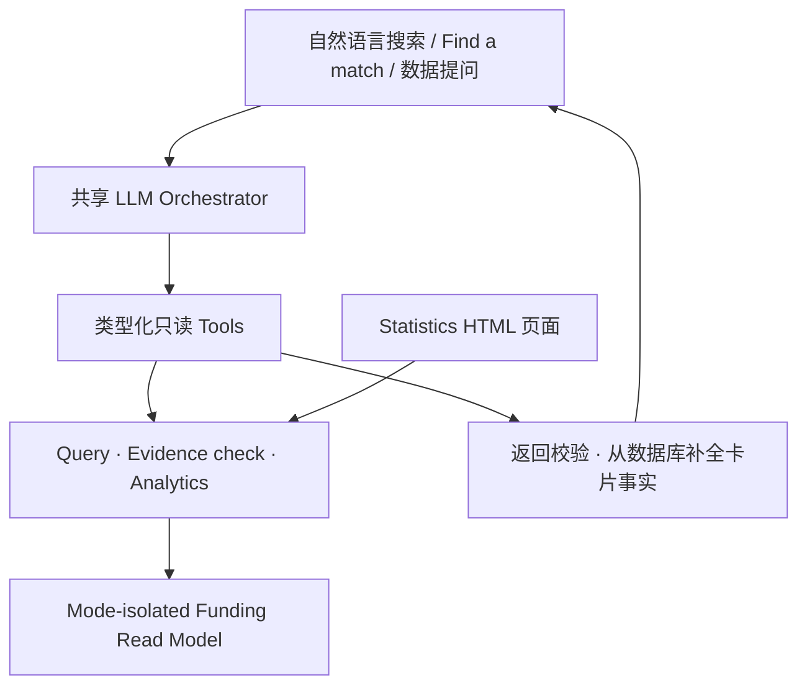

# Funding Navigator：Mentor Feedback 后端重设计

版本：v5 · 2026-10-10。决策已落实：**自然语言 + LLM + 后端数据 tools**，不再以问卷作为匹配入口。

## 1. 产品结构

侧栏新增 **Statistics**。应用保留 Explore、Saved、Profile；Profile 改为对话中自愿提供的上下文，而不是三题问卷。

| 入口 | 用户操作 | 后端行为 | 前端呈现 |
| --- | --- | --- | --- |
| Smart search | “我是 BC 的 Métis 学生，想找 training support” | 同一 LLM orchestrator 将意图转成类型化查询，调用搜索 tools | 可编辑的筛选条件、来源关联的项目卡片 |
| Find a match | 用自己的话描述学习计划，继续自然语言对话 | LLM 查询候选项目、调用证据检查 tool、排序；需要时一次追问一个有用信息 | 对话 + 项目卡片 + 待确认事项，不显示虚构成功率 |
| Statistics | 点击地图、图表或筛选 | 直接调用确定性的 analytics service | KPI、加拿大地图、分布图、金额明细、CSV |
| Ask about the data | “比较全国和 BC 的项目覆盖” | 同一 LLM 调用同一个 analytics tool | 有口径的统计答案，不另造一份统计数据 |

Statistics 采用 **HTML / CSS / JavaScript + SVG**，不依赖 Power BI embed、Canvas 截图或图片生成。图表由数据驱动。

## 2. 一套 LLM 技术栈，不建两套匹配服务



技术栈：Python 3.11+、FastAPI、Pydantic 2、SQLAlchemy、Alembic、SQLite 本地数据库；LLM 使用官方 OpenAI SDK 的 Responses API、function calling、Structured Outputs。模型由 `OPENAI_MODEL` 配置，不固定未经验证的“最新模型”。

匹配由 LLM 管理意图、对话和候选排序。证据条件检查作为 LLM 的后端 tool，用于返回已记录条件、未知信息和来源缺口；它不是另一个问卷或对话系统。Statistics 不必经过 LLM 才能显示；用户询问统计时，LLM 调用与面板相同的服务。

### Tool registry

| Tool | 输入 | 输出与边界 |
| --- | --- | --- |
| `search_opportunities` | SearchFilters、分页 | 发布记录、总数、实际应用的筛选，最多 12 张 LLM 候选卡片 |
| `find_matches` | 同一 SearchFilters + 可选自报 Profile | 候选项目、条件检查结果、缺失字段、证据引用、provider confirmation |
| `get_opportunity` | opportunity_id | 当前筛选内的项目详情和来源 |
| `get_statistics` | 同一 SearchFilters | 真实计算的地区、类型、community、金额、时间统计 |
| `get_filter_options` | 空对象 | 支持的 facet 值与地区名称 |

不提供任意 SQL、网页抓取、文件操作、数据修改或用户给出的外部 URL tool。LLM 只返回检索到的项目 ID 和有限的说明代码；项目名称、金额、时间、链接和卡片字段由后端记录补全。最终 ID 必须同时属于本次工具返回集合和最终筛选结果，不能只验证 JSON 格式。

## 3. 搜索与匹配数据流

1. 前端提交 mode、自然语言消息、最多 10 条上下文、用户手动筛选和自愿提供的粗粒度 profile。
2. Orchestrator 理解意图并调用类型化 tool。Search 与 Match 使用同一工具注册表和 SearchFilters。
3. 查询服务执行过滤。一个字段内多选按 OR，字段之间按 AND。手动筛选对当前请求具有约束力；AI 提取的筛选可在界面编辑。对话可以通过后续消息调整 AI 条件。
4. LLM 根据检索结果返回排序或一个必要追问；不能把来源缺失猜成没有限制。
5. 后端校验返回 ID、schema、工具白名单和预算，补全 canonical card facts。
6. 前端显示结果、可编辑筛选、provider 链接和待确认项。未知金额、上限、来源未验证都保持标记。

请求默认上限：4 轮模型调用、6 次 tool 调用，每次 1,800 output tokens；provider timeout 20 秒，SDK 最多重试一次。未配置、超时、拒绝、不完整输出、无效 tool 或无法核对的 ID 返回明确错误，不退回关键词规则并冒充 LLM。关键词搜索保留为单独明确标注的模式。

## 4. Filter redesign

首屏四个更大的带标签控件：Community、Study region、Funding type、Listed figure。支持加拿大全部 13 个省／地区。

More filters：Study plans、Education level、Field of study、Full/part-time、Funding covers（学费、生活、交通、书本）、Renewal、Deadline type、Provider、National/regional coverage。

筛选 schema 是前端手动筛选、LLM tool 和 analytics service 的共同契约，不使用三个不同的字段体系。自然语言中多个 community 或省份可以保留为多选结果，不能只留下第一个。

来源未知字段为 null，而非空条件。默认保留未知记录，并有“Keep unspecified details”开关；关闭时严格筛选。这一行为在 Search 与 Statistics 一致。当前四条示例没有明确教育阶段、专业、学习模式、费用项目和续期事实，因此保留为未知，不能为让新筛选显得丰富而填造值。

Profile 必须区分 residence province、institution province；未来导入原规范的 home community / citizenship / beneficiary 条件时，保持字段分离。此原型不收集身份号码，也不把 broad community tag 当作资格证明。

## 5. Statistics 信息架构与口径

面板包含：

- KPI：选中独立项目数、全国适用数、区域限定数、金额有记录的覆盖率。
- Natural Earth 加拿大省／地区地图：Regional 与 Incl. national 两种计数方式；地图键盘操作与完整区域表格可用。
- Funding programs / Scholarships composition 圆环图。
- Community 覆盖横向条形图。
- 示例金额区间分布图，以及 deadline 类型分布图。
- 每个项目的金额、区域、金额含义明细，可打开原 program record。
- 所有图表点击可联动筛选；Explore this selection 保留选择；CSV 导出当前记录并携带 demo 标记。

### 不会混淆的指标

| 问题 | 正确口径 |
| --- | --- |
| 全国有几个项目？ | distinct opportunity_id；同一个全国项目只计算一次 |
| BC 有几个？ | 区域限定 BC 项目与全国覆盖项目分别显示；reach 是二者的独立记录数 |
| 各区域相加能得全国数吗？ | 不能；全国项目在 region reach 中重复，图例和表格明确说明 |
| 哪个 community 更多？ | 标签覆盖数；community 可以重叠，不当作互斥总量 |
| 每个项目多少钱？ | 保留原币种、单位、固定金额、范围、上限、pool、variable、unknown；不把 cap 当作 guaranteed award |
| 总资金是多少？ | 本原型不计算；两条示例上限与两条未知金额不能推导 funding pool |
| 这是加拿大市场全貌吗？ | 不是。当前仅四条示例；覆盖率、数据模式和验证状态必须可见 |

金额持久化使用 decimal strings；未知不是 0。`pooled_total` 不能进入 per-student 金额分布，混合币种和单位不能直接平均。后续 live analytics 应先按币种／单位／金额语义分组，并显示已知金额分母；award_collection 默认不进入独立项目统计。

## 6. 数据基础与生产扩展

沿用原先后端规范的思路：官方来源发现 → immutable snapshots → 提取 → 字段与 evidence / semantic validation → 幂等导入 → publishable read model。新增聊天不会替代来源采集与验证。

**本轮已实际新增的是 application backend / read model，不是完整 crawler 或原规范全部采集流水线。** 之前只有静态前端，没有现存后端代码可直接复用。当前 Alembic migration 建立 mode 隔离的 opportunity read model，保存公开记录 JSON；数据库不存 profile / conversation。

后续把经过原规范验证的 canonical JSONL 接到 read-model publisher。live publisher 应：

1. 接收 `award / funding_channel / award_collection`、稳定 ID、cycles、amount semantics、deadline timezone、rule AST、application group、field evidence、review/publication 状态。
2. 只发布达到原规范 publication gate 的真实记录，不能仅靠 LLM confidence 或 HTTP 200。
3. 建立 `opportunity_region`、`cycle_amount`、facets 和证据关联投影；多区域用 association rows，不能拆成重复 award。
4. 按 snapshot / schema / publisher version 刷新投影；保留历史 cycle，不删除来源暂时消失的项目。
5. 将本原型最多 5,000 条的 Python 聚合换成同契约的 SQL aggregation / views；先按独立 ID 去重再 join faceting tables。
6. live 与 demo 使用不同数据库和导出路径；集合页、草稿和合成数据不进入 live 匹配与统计。

公开页面提取 LLM 与面向学生的对话 LLM 是不同的用途、prompt 和 cache。提取仅处理公开源文本；学生 profile 不送给提取任务。自然语言工具只能读取发布后的数据。

## 7. API contract

| Method / endpoint | 职责 |
| --- | --- |
| `GET /api/health` | 数据模式、migration 状态、LLM 是否配置，不返回密钥 |
| `POST /api/opportunities/search` | 同一类型化筛选、稳定分页和 canonical records |
| `GET /api/opportunities/{id}` | 公开来源详情 |
| `POST /api/match/evaluate` | 可独立测试的条件／证据检查 tool |
| `POST /api/statistics` | 面板和 LLM 共用的分析 API |
| `GET /api/facets` | 筛选词典 |
| `POST /api/conversation` | 同一 orchestrator；mode = search / match / analysis |
| `GET /api/docs` | 实际运行时的 OpenAPI 文档 |

例子：

```json
{
  "mode": "match",
  "message": "I’m a Métis student in BC looking for training support",
  "history": [],
  "filters": {"include_unknown": true},
  "profile": {}
}
```

生产接口需增加平台身份校验、每用户请求预算／rate limiting、非敏感统计 telemetry、请求整体 deadline 和评测发布门槛。当前服务默认仅监听 localhost；没有账户系统、文档上传和公开写接口。

## 8. 隐私与错误处理

对话仅保存在浏览器内存。Saved 只存项目 ID。后端不写用户 profile、消息、证件或请求正文；validation error 不反射输入值。真实 AI 配置后，消息和自愿提供的 broad profile 会发送给 LLM provider；`store:false` 不应宣称等同于 provider 完全零留存。

示例不收集姓名、邮箱、SIN、Status Card、student number 或申请材料。明显的邮箱和证件编号输入在请求模型前拒绝。所有来源文字和 LLM 输出都被视为不可信内容；runtime tools 是固定白名单。

## 9. 本轮交付边界

已实现：Statistics HTML UI、13 区域地图、图表联动与 CSV、放大与扩展筛选、删除问卷、自然语言对话 UI、FastAPI 数据／分析服务、共享 Responses tools adapter、migration、幂等 demo 导入、离线测试、真实缺 key 错误。

待接入：真实 API key / model，托管的 API origin，以及经过完整 evidence publication gate 的 live 数据。当前静态发布会清楚显示 **AI not connected**；本地 FastAPI 同源运行并配置密钥后才调用真实 LLM。不将 offline provider fixture 发布为聊天功能。

当前数据：4 条沿用来源的 illustrative examples；0 条经本轮审核的 live records；0 个已验证当前 cycle。图表显示这个数据集，不制造额外全国记录。

技术依据：[OpenAI Function calling](https://developers.openai.com/api/docs/guides/function-calling)、[Structured Outputs](https://developers.openai.com/api/docs/guides/structured-outputs?api-mode=responses)、[FastAPI Testing](https://fastapi.tiangolo.com/tutorial/testing/)、[SQLAlchemy Sessions](https://docs.sqlalchemy.org/en/20/orm/session_basics.html)、[Alembic Tutorial](https://alembic.sqlalchemy.org/en/latest/tutorial.html)、[Natural Earth license](https://www.naturalearthdata.com/about/terms-of-use/)。
